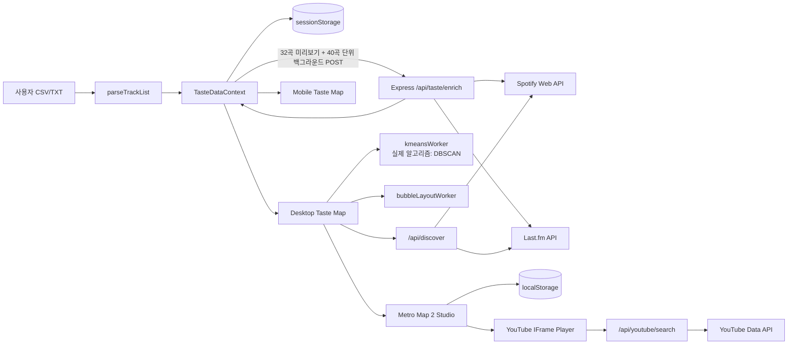

# SPECTRA Taste Map 개발 기술서

- 문서 기준일: 2026-09-08
- 코드 기준 브랜치/커밋: `dev_chang` / `f2edcc7`
- 애플리케이션 버전: `0.1.0`
- 대상 저장소: `spectra-taste-map`
- 문서 목적: 현재까지 구현된 기능, 기술 구조, 데이터 흐름, 실행·배포 방법과 남은 기술 과제를 실제 코드 기준으로 정리한다.

## 1. 프로젝트 개요

SPECTRA Taste Map은 사용자가 직접 가져온 음악 목록을 장르·무드 기반의 공간 데이터로 변환해 탐색하는 웹 애플리케이션이다. Spotify 계정 로그인이나 사용자 라이브러리 권한을 요구하지 않고, CSV/TXT 또는 `Artist - Title` 형식의 텍스트를 입력으로 사용한다.

현재 제품의 핵심 경험은 다음 네 가지다.

1. Last.fm 태그와 Spotify 공개 카탈로그 정보를 결합한 음악 데이터 보강
2. 장르/감정 특성을 버블 필드와 별자리 형태로 보여주는 데스크톱 Taste Map
3. 선택한 음악을 노선·역·열차로 바꾸는 Metro Map 2 편집기
4. Metro 열차 경로의 곡을 YouTube 영상으로 연속 재생하는 인앱 플레이어

로그인, 서버 데이터베이스, 사용자별 원격 저장소는 현재 없다. 가져온 데이터와 사용자가 만든 그룹·노선도는 브라우저 저장소에 보관된다.

## 2. 현재 구현 상태 요약

| 영역 | 상태 | 비고 |
| --- | --- | --- |
| CSV/TXT/붙여넣기 가져오기 | 구현 완료 | 헤더 자동 인식, 중복 제거, 32곡 미리보기 후 백그라운드 보강 |
| Spotify 공개 메타데이터 보강 | 구현 완료 | Client Credentials, 커버·링크·아티스트 장르 |
| Last.fm 태그 보강 | 구현 완료 | 트랙 태그, 아티스트 태그 폴백 |
| Taste Map 데스크톱 | 구현 완료 | Spotify Field, Constellation, 축·필터·탐색·스토리·그룹 선택 |
| Taste Map 모바일 | 부분 구현 | 장르별 추천 카드 중심의 간소화 화면이며 데스크톱 기능 전체와 동등하지 않음 |
| 추천 탐색 | 구현 완료 | Last.fm/Spotify 소스별 후보 수집 후 현재 축 거리로 정렬 |
| Metro Map 2 | 구현 완료 | 생성, 편집, 저장, 열차, YouTube 재생 |
| 플레이리스트 내보내기 | 미구현 | UI는 비활성화된 `준비 중` 상태 |
| 서버 영속 저장/계정 동기화 | 미구현 | 브라우저별 로컬 저장만 지원 |
| 자동 테스트 | 미구현 | 테스트 러너 및 테스트 코드 없음 |
| 프로덕션 빌드 | 성공 | 2026-09-02 `npm run build` 확인 |
| 정적 분석 | 실패 | 2026-09-02 기준 ESLint 29 errors, 1 warning |

## 3. 기술 스택

### 3.1 프런트엔드

| 기술 | 역할 |
| --- | --- |
| React 19 | 화면과 상태 기반 UI 구현 |
| React DOM 19 | 브라우저 렌더링 |
| React Router DOM 7 | `/taste-map`, `/taste-map/mobile` 라우팅 |
| Vite 7 | 개발 서버, 번들링, Web Worker 빌드 |
| Three.js 0.184 | 가져오기 오버레이의 3D 배경과 일부 분석/3D 코드 경로 |
| Web Workers | DBSCAN 클러스터링과 버블 충돌 배치를 메인 스레드 밖에서 계산 |
| CSS | 전용 컴포넌트 스타일, 반응형 UI, 애니메이션 |
| YouTube IFrame API | Metro 경로의 실제 영상 재생과 재생 상태 동기화 |

### 3.2 백엔드·외부 API

| 기술 | 역할 |
| --- | --- |
| Node.js + Express 4 | API 서버와 프로덕션 정적 파일 제공 |
| Spotify Web API | Client Credentials 기반 공개 트랙·앨범·아티스트 메타데이터 검색 |
| Last.fm API | 트랙/아티스트 태그, 유사곡, 태그별 대표곡 조회 |
| YouTube Data API v3 | 재생 가능한 영상 후보 검색 |
| Vercel Functions | Express 앱을 API 엔드포인트별 서버리스 함수로 노출 |
| dotenv | 로컬 환경변수 로딩 |

현재 Vite 7의 엔진 조건은 Node `^20.19.0 || >=22.12.0`이다. 기존 README의 `Node 18+` 안내는 실제 의존성 조건에 맞게 갱신할 필요가 있다.

## 4. 전체 아키텍처



핵심 원칙은 브라우저가 외부 서비스의 비밀 키를 직접 가지지 않는 것이다. Spotify Client Secret, Last.fm API Key, YouTube API Key는 모두 서버에서만 사용한다.

## 5. 사용자 데이터 처리 흐름

### 5.1 목록 파싱

`src/utils/parseTrackList.js`가 다음 입력을 처리한다.

- Tune My Music, Exportify, Soundiiz 계열 CSV
- `Artist - Title`, `Artist – Title`, `Artist — Title` 형식
- 탭으로 구분된 아티스트/제목
- 헤더 없는 2~3열 CSV

CSV 헤더에서는 artist, track/title/name, album, added/date 계열 열을 자동으로 찾는다. 결과는 아래 형태로 정규화하고, 아티스트+제목의 소문자 조합으로 중복을 제거한다.

```json
{
  "artist": "Daft Punk",
  "title": "Around the World",
  "album": "Homework",
  "addedAt": "2025-01-01"
}
```

### 5.2 클라이언트 가져오기

`TasteDataContext`는 전체 목록에서 고르게 뽑은 32곡을 먼저 `POST /api/taste/enrich`로 전송한다. 이 대표 샘플이 준비되면 전체 화면 로딩을 끝내고 바로 지도를 연다. 나머지는 40곡 단위의 단일 백그라운드 작업으로 보강하며 5개 청크마다 지도 데이터를 갱신한다. 각 응답의 트랙은 최종 ID 기준으로 중복 제거하고, 가져오기마다 새 `mapId`를 만든다.

백그라운드 처리 중에는 데스크톱 헤더에 `나머지 곡 추가 중 n%`를 표시한다. 타임아웃, 429, 5xx, 네트워크 오류는 자동 재시도한다. 서버리스 타임아웃 성격의 실패가 계속되면 청크를 최소 10곡까지 재분할한다. 진행 중 페이지가 다시 로드되어도 원본 목록을 세션에서 복구해 보강 작업을 자동 재개한다.

Spotify 요청은 서버 프로세스 전체에서 시작 간격을 조절한다. 429 응답을 받으면 `Retry-After`를 공유 cooldown으로 등록해 대기 중인 모든 Spotify 요청을 함께 멈추고, cooldown 이후에도 동시에 재개하지 않도록 순차적으로 출발시킨다.

성공 결과는 `sessionStorage`의 `spectra:taste:v5`에 저장된다. 따라서 같은 탭 세션에서는 새로고침 후에도 복구되지만, 계정이나 다른 기기로 동기화되지는 않는다.

### 5.3 서버 데이터 보강

서버는 각 트랙에 대해 Spotify와 Last.fm 조회를 병렬 실행한다.

- Spotify: 트랙명/아티스트/앨범 유사도를 점수화해 공개 카탈로그에서 최적 후보 선택
- Spotify: 앨범 커버, 재생 시간, 인기도, 외부 URL, 아티스트 장르 조회
- Last.fm: `track.getInfo`로 태그·앨범·재생 시간 조회
- Last.fm: 트랙 태그가 없으면 `artist.getTopTags` 사용
- 외부 ID가 없으면 SHA-1 기반의 안정적인 대체 ID 생성

최종 트랙의 대표 형태는 다음과 같다.

```json
{
  "id": "spotify-id-or-generated-id",
  "name": "Track title",
  "artists": "Artist name",
  "album": "Album title",
  "coverUrl": "https://...",
  "coverSource": "spotify",
  "durationMs": 210000,
  "addedAt": "2025-01-01",
  "popularity": 72,
  "valence": 0.65,
  "energy": 0.72,
  "danceability": 0.75,
  "acousticness": 0.15,
  "instrumentalness": 0.05,
  "genres": ["house", "electronic"],
  "spotifyGenres": ["french house"],
  "spotifyFeatures": {
    "valence": 0.65,
    "energy": 0.72,
    "danceability": 0.75,
    "acousticness": 0.15,
    "instrumentalness": 0.05
  },
  "externalUrl": "https://open.spotify.com/...",
  "featuresSource": "lastfm"
}
```

### 5.4 특성값 산정의 제약

현재 `valence`, `energy`, `danceability`, `acousticness`, `instrumentalness`는 Spotify Audio Features의 실측값이 아니다. Spotify Development Mode에서 Audio Features를 사용할 수 없어, Last.fm 태그 또는 Spotify 아티스트 장르를 서버의 룰 테이블로 매핑한 추정값이다.

- 기본값: valence/energy/danceability/acousticness `0.5`, instrumentalness `0`
- 장르·무드별 valence/energy 점수를 평균
- danceability는 energy에서 파생
- acousticness와 instrumentalness는 장르 키워드로 추정

이 값은 음악적 경향을 시각화하기 위한 휴리스틱이며, 정밀 오디오 분석 결과로 해석하면 안 된다.

## 6. Taste Map 데이터 분석

### 6.1 두 가지 데이터 필드

- Last.fm 계열: `genres`와 최상위 특성값을 사용한다.
- Spotify Field: 같은 트랙에서 `spotifyGenres`와 `spotifyFeatures`를 최상위 값으로 덮어 사용한다.
- Constellation: Last.fm 계열 트랙 데이터에 별자리 렌더링을 적용한다.

맵 레지스트리에는 `field`, `spotify`, `constellation`이 존재하지만, 현재 화면의 탭에는 `spotify`와 `constellation`만 노출된다. `field`는 `showInNavigation: false`로 숨겨진 상태다. 초기 선택은 Spotify Field다.

### 6.2 클러스터링 Worker

파일명은 `kmeansWorker.js`지만 현재 실제 알고리즘은 자동 파라미터 DBSCAN이다.

1. 장르 기준일 때 최대 28개 장르 어휘를 만들고 IDF 가중 벡터로 변환
2. 장르 데이터가 부족하면 5차원 특성 벡터로 폴백
3. 표본의 k-nearest distance로 `eps`, 데이터 크기로 `minPts` 추정
4. `eps`의 0.88배, 1배, 1.12배 후보를 각각 계산
5. 클러스터 수, 노이즈 비율, 최대 클러스터 비중, 크기 편차 점수로 최적 결과 선택
6. DBSCAN 노이즈는 별도 노이즈 클러스터로 묶음

Worker는 장르 벡터의 PCA 유사 2D/3D 투영값도 반환하지만, 현재 `TasteMapPage`는 이 투영값을 상태에 저장하지 않는다. 사용되지 않는 계산이므로 후속 정리 대상이다.

### 6.3 버블 배치 Worker

`bubbleLayoutWorker.js`는 선택한 X/Y 특성값으로 초기 위치를 만들고, 공간 그리드 기반 충돌 해소를 수행한다.

- 데이터량별 버블 크기·간격 조절
- Spotify popularity를 버블 크기 가중치로 사용
- 클러스터 중심으로 약하게 당겨 군집 형태 유지
- 450/900/1,600곡 구간에 따라 반복 횟수를 줄여 대규모 데이터 처리
- 결과 좌표를 0~1 범위로 정규화해 메인 스레드에 반환

현재 최근 재생 데이터는 제거되어 `recentPlayMap`이 비어 있으므로, 실질적인 크기 가중치는 Spotify popularity 또는 기본값이다.

### 6.4 렌더링 성능 전략

- 맵 분석 대상은 최대 2,000곡으로 샘플링
- 현재 뷰포트와 overscan에 해당하는 버블만 DOM에 마운트
- 줌에 따라 최대 320/420/520개의 버블만 마운트
- 히트맵은 화면 내 버블에서 최대 약 360개를 샘플링
- 자석 인터랙션은 재클러스터링 없이 가까운 DOM 요소의 CSS 변수만 변경
- resize는 150ms debounce 후 Worker를 재실행
- 클러스터 결과는 트랙 시그니처와 소스별로 10분간 `sessionStorage` 캐시
- 전체 목록을 기다리지 않고 32곡 대표 샘플로 첫 지도를 먼저 표시
- 나머지 보강 결과는 4개 청크 단위로 합쳐 불필요한 재클러스터링 횟수를 제한

## 7. 데스크톱 기능

### 7.1 맵 탐색

- Spotify Field와 Constellation 전환
- 드래그 팬, 휠/핀치 줌, 확대/축소/전체 맞춤
- 전체화면과 Escape 종료
- 버블 hover, 상세 카드, 우클릭 컨텍스트 메뉴
- 클러스터 태그 필터와 전체 보기
- 밀도 히트맵과 클러스터 영역 라벨
- 다크/라이트 맵 테마
- 한국어/영어 전환

### 7.2 축과 프리셋

사용 가능한 축은 valence, energy, danceability, acousticness, instrumentalness다.

| 프리셋 | X | Y |
| --- | --- | --- |
| 기분 맵 | valence | energy |
| 댄스 맵 | danceability | energy |
| 어쿠스틱 맵 | acousticness | valence |

### 7.3 자석·별자리 인터랙션

자석 모드는 포인터 인근 버블을 시각적으로 끌어당긴다. Constellation은 버블을 작은 별처럼 표현하고, 가까운 노드와 짧은 연결선을 만들며, 일정 줌 이상에서 앨범 커버를 표시한다.

### 7.4 탐색 추천

탐색은 특정 곡 또는 현재 취향의 저밀도 영역을 기준으로 실행된다.

- Spotify Field: 같은 아티스트 및 장르 검색 후보
- Last.fm/Constellation: 유사곡 및 태그 대표곡 후보
- 현재 X/Y 축의 목표 좌표와 가까운 순서로 정렬
- 기존 필드 위에 추천 버블과 orbit을 오버레이
- 추천곡을 현재 브라우저의 필드 상태에 추가하거나 Spotify/YouTube 검색으로 이동

추천곡의 `내 필드에 추가`는 서버 라이브러리에 저장하는 기능이 아니라 현재 클라이언트 상태에 합치는 동작이다.

### 7.5 인사이트와 스토리

- Field Inspector: 클러스터, 대표 장르, 대표곡, 특성값 확인
- Taste Story: 현재와 연도별 장르 페르소나 비교
- 비교 모드: blend/split
- 소스 선택 UI: recent/liked/top
- Taste Universe Snapshot: 곡 수, 우세 분위기, 다양성, 현재 축 평균

연도 비교는 입력 데이터의 `addedAt`에 의존한다. 날짜가 없는 텍스트 목록에서는 연도별 분석이 제한될 수 있다. 또한 과거 Spotify 로그인 기능에서 사용하던 recent/liked/top 및 Memory Shelf 관련 일부 UI·상태가 남아 있으나 현재 데이터 소스는 연결되지 않아 빈 상태다.

### 7.6 선택 그룹

- 선택 모드에서 클릭 또는 드래그 사각형으로 여러 곡 선택
- Shift를 이용한 추가 선택
- 그룹 이름 지정, 생성, 수정, 삭제
- 그룹별 색상과 트랙 스냅샷 저장
- Metro Map 2에서 사용자 그룹을 노선 입력으로 재사용

플레이리스트 내보내기 버튼은 현재 비활성화되어 있다.

## 8. 모바일 기능

`max-width: 900px`에서는 `TasteMapMobilePage`를 표시한다. 현재 모바일 화면은 데스크톱 맵의 축소판이 아니라 추천 탐색에 집중한 별도 경험이다.

- 희소 장르 중심의 장르 칩 최대 8개 표시
- 선택 장르와 대표곡을 기준으로 `/api/discover` 호출
- 추천곡 최대 12개를 카드 단위로 순환
- 커버 클릭 시 Spotify 외부 페이지 열기
- `나의 spectra에 추가`: 현재 컴포넌트 세션 상태에 추천곡 추가
- `버블 터뜨리기`: 추천 거절 표시 후 다음 곡으로 이동

모바일의 수락/거절 상태는 새로고침을 견디는 별도 저장소에 기록되지 않는다. 데스크톱의 클러스터 맵, Metro Studio, 그룹 편집, 스토리 기능과도 동등하지 않다.

## 9. Metro Map 2

### 9.1 진입 구조

곡 상세 카드는 축소된 Metro 패널과 연결되고, 확장 시 `TasteMapMetroStudio`가 전체 편집 경험을 제공한다. Metro 데이터는 현재 Taste Field의 트랙, 클러스터, 사용자 그룹을 입력으로 사용한다.

### 9.2 노선도 생성

두 가지 생성 모드를 지원한다.

- 취향 조합형: Taste Field의 클러스터 또는 장르 그룹을 노선으로 사용
- 중심곡 방사형: 한 곡을 중심역으로 지정하고 관련 장르별 노선을 방사형으로 생성

생성 옵션은 노선당 최대 역 수, 전체 최대 역 수, 자동/수동/없음 환승 방식, 환승곡 수다. 곡이 많으면 popularity와 안정적인 해시 점수를 혼합해 표본을 선택한다.

### 9.3 레이아웃과 편집

- 기본 캔버스: 2,400 × 1,440
- 그리드: 80px
- 직교 노선과 둥근 코너 SVG 경로 생성
- 역 드래그, 그리드 자석 스냅, 점유 위치 회피
- 역 순서 변경과 교환
- 노선/곡 추가, 노선/역 삭제, 환승역 지정
- 노선도 복제·삭제·레이아웃 초기화
- 팬, 줌, 화면 맞춤
- SVG 다운로드
- 최대 80단계 undo/redo와 `Cmd/Ctrl+Z`, redo 단축키
- 브라우저 자동 저장

현재 라우팅에서 사용되는 구현은 `TasteMapMetroStudio.jsx`와 `metroMap2Engine.js`다. `TasteMapSubwayGenerator.jsx`와 `tasteMapSubwayEngine.js`는 1세대 생성기 코드로 저장소에는 남아 있지만 어느 화면에서도 import되지 않는다.

### 9.4 열차와 경로

- 노선 전체 또는 인접 역을 직접 선택해 열차 경로 생성
- 열차 이름, 색상, 속도 설정
- 경로의 역 목록을 곡 큐로 사용
- 지도 위 열차 위치·진행률·다음 역 표시
- 열차를 드래그해 가까운 노선과 위치에 배치
- 재생/일시정지/출발점 복귀/삭제

현재 UI 정책상 한 노선도에는 열차 한 대만 운행할 수 있다.

### 9.5 YouTube 재생

1. 클라이언트가 아티스트·곡명으로 `/api/youtube/search` 호출
2. 서버가 YouTube Data API에서 임베드 가능한 후보 5개 조회
3. 제목·아티스트·official/audio 키워드를 점수화하고 cover/karaoke/nightcore 등의 비의도 후보 감점
4. 최적 videoId를 클라이언트에 반환
5. YouTube IFrame API가 실제 재생 상태와 시간을 전달
6. 곡 종료 시 경로의 다음 역 곡으로 이동

플레이어는 재생/일시정지, 이전/다음, seek, 큐 위치 표시를 지원하며 창을 드래그하거나 크기를 조절할 수 있다. 브라우저 자동재생 정책에 막히면 사용자의 명시적 재생 입력이 필요하다.

## 10. API 명세

### 10.1 `POST /api/taste/enrich`

요청:

```json
{
  "tracks": [
    { "artist": "Artist", "title": "Title", "album": "Album", "addedAt": "2025-01-01" }
  ]
}
```

응답:

```json
{
  "tracks": [],
  "featuresSource": "lastfm",
  "stats": {
    "fetchedCount": 0,
    "totalAvailable": 0,
    "spotifyMatchedCount": 0,
    "lastfmTaggedCount": 0,
    "lastfmMatchedCount": 0,
    "spotifyGenreCount": 0,
    "spotifyErrorCount": 0,
    "cacheHit": false
  }
}
```

서버의 `ENRICH_MAX_TRACKS`는 요청 하나에 대한 제한이다. 현재 클라이언트는 첫 32곡 이후 전체 목록을 40곡씩 계속 보내므로, 이 설정이 사용자 1회 가져오기의 총곡 수를 제한하지는 않는다.

### 10.2 `GET /api/discover`

주요 쿼리:

- `source=lastfm|spotify`
- `xAxis`, `yAxis`
- `targetX`, `targetY`
- `seedGenres`: 쉼표 구분
- `seedTracks`: `artist|title;artist|title`
- `limit`: 1~50

응답은 추천 `tracks`와 실제 탐색 기준 `seed`를 반환한다.

### 10.3 `GET /api/youtube/search`

쿼리:

- `artist`
- `title`

응답:

```json
{
  "video": {
    "videoId": "...",
    "title": "...",
    "channelTitle": "...",
    "thumbnailUrl": "..."
  }
}
```

YouTube 키가 없으면 `503 YOUTUBE_NOT_CONFIGURED`, 입력이 없으면 `400 INVALID_TRACK`을 반환한다.

## 11. 캐시와 저장소

| 저장 위치 | 키 | 내용 | 수명 |
| --- | --- | --- | --- |
| sessionStorage | `spectra:taste:v5` | 보강된 트랙, 통계, mapId, 진행 중 원본 목록 | 브라우저 탭 세션 |
| sessionStorage | `taste-map-cluster-v3|...` | DBSCAN 결과 | 10분 TTL |
| localStorage | `spectra-tastemap-lang-v1` | KO/EN 언어 | 직접 삭제 전까지 |
| localStorage | `spectra-tastemap-theme-v1` | day/dark 테마 | 직접 삭제 전까지 |
| localStorage | `spectra-custom-groups-v1.{mapId}` | 사용자 음악 그룹 | 직접 삭제 전까지 |
| localStorage | `spectra.metro-map-2.{mapId}` | 노선도·열차 정의 | 직접 삭제 전까지 |
| localStorage | `spectra.youtube-video.v1.*` | 곡별 YouTube 영상 매칭 | 30일 |
| 서버 메모리 | Spotify/Last.fm 캐시 | 외부 API 응답 | 기본 24시간, 프로세스 재시작 시 소멸 |
| 서버 메모리 | YouTube 캐시 | 영상 매칭 | 기본 30일, 프로세스 재시작 시 소멸 |

`TM_FETCH_CACHE_PREFIX`, `TM_LIBRARY_CACHE_PREFIX` 상수는 남아 있으나 현재 코드에서는 실제 캐시 읽기/쓰기에 사용되지 않는다.

## 12. 실행과 환경설정

### 12.1 필수 환경변수

```dotenv
SPOTIFY_CLIENT_ID=...
SPOTIFY_CLIENT_SECRET=...
SPOTIFY_MARKET=KR
SPOTIFY_REQUEST_MIN_INTERVAL_MS=220
SPOTIFY_RATE_LIMIT_MAX_WAIT_MS=120000
LASTFM_API_KEY=...
YOUTUBE_API_KEY=...
YOUTUBE_REGION=KR
```

YouTube는 Metro 영상 재생을 쓰지 않으면 선택 사항이다. Spotify와 Last.fm은 `/api/taste/enrich`의 현재 구현에서 모두 필요하다. 오프라인 데모는 아래 설정을 지원한다.

```dotenv
SPOTIFY_MOCK=1
LASTFM_MOCK=1
```

추가 조정값은 `.env.example`의 cache TTL, cache max, Spotify 동시성·timeout·circuit breaker, `ENRICH_MAX_TRACKS`를 참고한다. `VITE_API_BASE`, `VITE_PROXY_TARGET`도 코드에서 지원하지만 `.env.example`에는 아직 문서화되어 있지 않다.

### 12.2 개발 실행

```bash
npm install
cp .env.example .env
npm run dev:all
```

- Vite: `http://127.0.0.1:5173`
- Express: `http://127.0.0.1:3001`
- 개발 중 `/api`는 Vite 프록시를 통해 Express로 전달

개별 실행:

```bash
npm run server
npm run dev
```

### 12.3 빌드와 배포

```bash
npm run build
npm run server
```

직접 실행한 Express 서버는 `dist/`가 있을 때 정적 파일과 SPA fallback을 함께 제공한다. Vercel에서는 `api/`의 세 함수가 동일한 Express 앱으로 요청 URL을 재작성해 전달하고, `vercel.json`이 `/taste-map` 하위 경로를 `index.html`로 보낸다.

## 13. 디렉터리 구조

```text
.
├── api/
│   ├── discover.js                  # Vercel discover 함수
│   ├── taste/enrich.js              # Vercel enrich 함수
│   └── youtube/search.js            # Vercel YouTube 함수
├── docs/
├── public/                           # SPECTRA 마크
├── src/
│   ├── App.jsx                       # 가져오기 화면, 라우팅, 반응형 분기
│   ├── context/TasteDataContext.jsx  # 가져오기 상태와 세션 저장
│   ├── pages/
│   │   ├── TasteMapPage.jsx          # 데스크톱 메인 화면
│   │   ├── TasteMapMobilePage.jsx    # 모바일 추천 화면
│   │   ├── TasteMapMetroStudio.jsx   # Metro Map 2 UI/상태
│   │   ├── metroMap2Engine.js        # Metro 생성·배치·경로 계산
│   │   ├── MetroYouTubePlayer.jsx    # YouTube IFrame 플레이어
│   │   ├── TasteMapSubwayGenerator.jsx # 미연결 1세대 생성기
│   │   └── tasteMapSubwayEngine.js   # 미연결 1세대 엔진
│   ├── server/
│   │   ├── spotify.js                # Spotify 카탈로그 클라이언트
│   │   ├── lastfm.js                 # Last.fm 클라이언트
│   │   └── youtube.js                # YouTube 검색 클라이언트
│   ├── utils/parseTrackList.js
│   └── workers/
│       ├── kmeansWorker.js            # DBSCAN/장르 벡터 처리
│       └── bubbleLayoutWorker.js       # 버블 충돌 배치
├── server.js                           # Express API와 정적 서버
├── vite.config.js
└── vercel.json
```

## 14. 보안·개인정보 특성

- 외부 API 비밀 키와 Spotify access token은 서버에서만 사용한다.
- Spotify 사용자 OAuth를 사용하지 않으므로 개인 Spotify 라이브러리에 직접 접근하지 않는다.
- 사용자가 가져온 아티스트/곡명은 보강 과정에서 서버와 Spotify/Last.fm으로 전달된다.
- YouTube 재생 시 해당 아티스트/곡명이 YouTube 검색 API로 전달된다.
- 애플리케이션 데이터베이스는 없으며, 현재 서버 코드가 가져온 곡 목록을 영속 저장하지 않는다.
- 브라우저 저장 데이터는 암호화되지 않으며 같은 브라우저 프로필에서 접근 가능하다.
- API 인증, 사용자별 접근제어, 명시적 rate limit은 현재 없다.
- 입력 검증은 수동 문자열 정규화 수준이며 스키마 검증 라이브러리는 사용하지 않는다.

공개 서비스로 확장할 때는 API rate limit, 요청 크기와 총곡 수 제한, 관측성, 개인정보 고지, 저장소 삭제 UX를 추가해야 한다.

## 15. 검증 결과

2026-09-02 현재 저장소에서 확인한 결과다.

### 15.1 성공

```text
npm run build
✓ 56 modules transformed
✓ built
```

생성 번들 중 `three.module`은 약 732.65kB로 Vite의 500kB 경고 기준을 넘는다. 메인 JS는 약 482.07kB, 전체 CSS는 약 215.45kB다.

### 15.2 실패

```text
npm run lint
✖ 30 problems (29 errors, 1 warning)
```

주요 오류 유형은 다음과 같다.

- effect 본문에서 동기 `setState` 호출
- 렌더 중 ref 전달/접근
- 컴포넌트 내부에서 렌더마다 `FeatureBar` 컴포넌트 생성
- 사용하지 않는 변수
- 미연결 1세대 Subway Generator의 lint 오류

빌드는 통과하지만 lint를 품질 게이트로 사용할 수 없는 상태다.

## 16. 기술 부채와 권장 우선순위

### P0 — 배포 안정성

1. ESLint 29개 오류를 해소하고 CI 품질 게이트 추가
2. enrich API에 사용자 1회 가져오기 기준 총곡 수와 rate limit 적용
3. 외부 API 장애·quota·timeout에 대한 사용자 오류 메시지와 서버 관측성 보강
4. 핵심 흐름의 자동 테스트 추가: 파서, 특성 매핑, DBSCAN, Metro 경로, API 계약

### P1 — 구조 개선

1. 약 6,500줄의 `TasteMapPage.jsx`를 맵, 추천, 인사이트, 그룹, 스토리 단위로 분리
2. 약 3,500줄의 `TasteMapMetroStudio.jsx`를 생성기, 캔버스, 편집기, 열차, 플레이어 제어로 분리
3. `kmeansWorker.js`를 실제 알고리즘에 맞게 이름 변경
4. 사용하지 않는 PCA 결과, fetch/library 캐시 상수, 과거 OAuth 기반 Memory Shelf 상태 제거
5. 1세대 Subway Generator를 삭제하거나 별도 라우트로 공식 복원

### P2 — 제품 완성도

1. 모바일과 데스크톱 그룹/맵 상태 동기화
2. 플레이리스트 내보내기 구현
3. 서버 계정·DB를 도입할 경우 그룹/Metro Map의 기기 간 동기화와 권한 모델 설계
4. Three.js와 대형 화면 코드의 route/component 단위 code splitting
5. 휴리스틱 특성값을 UI에서 명확히 표시하고 실제 오디오 분석 도입 가능성 검토

## 17. 운영 전 체크리스트

- [ ] Node 20.19+ 또는 22.12+ 환경 사용
- [ ] Spotify, Last.fm, YouTube 서버 환경변수 설정
- [ ] 실제 CSV와 일반 텍스트 가져오기 검증
- [ ] 100곡, 500곡, 1,500곡 이상 입력의 응답시간과 quota 확인
- [ ] Spotify Field/Constellation 전환과 축 변경 확인
- [ ] Last.fm/Spotify 추천 소스와 축 정렬 확인
- [ ] 선택 그룹 생성·수정·삭제와 새로고침 복구 확인
- [ ] Metro 생성·역 이동·undo/redo·SVG 저장 확인
- [ ] 열차 경로와 YouTube 이전/다음/seek 동기화 확인
- [ ] 모바일 900px 이하 분기와 추천 카드 확인
- [ ] `npm run build` 성공
- [ ] `npm run lint` 성공
- [ ] API rate limit과 외부 서비스 quota 모니터링

## 18. 결론

현재 SPECTRA Taste Map은 단순한 음악 분포 시각화를 넘어, 취향 데이터 가져오기 → 다중 소스 보강 → 공간 클러스터링 → 추천 탐색 → 사용자 그룹 → Metro 노선과 실제 영상 재생까지 하나의 브라우저 경험으로 연결한 상태다.

기능 프로토타입의 범위는 넓고 프로덕션 빌드도 가능하지만, 품질 관점에서는 lint 오류, 자동 테스트 부재, 대형 컴포넌트, 휴리스틱 특성값, 브라우저 로컬 저장 의존성을 우선 정리해야 한다. 다음 단계는 신규 기능 확대보다 현재 경로의 안정화와 구조 분리가 적절하다.
